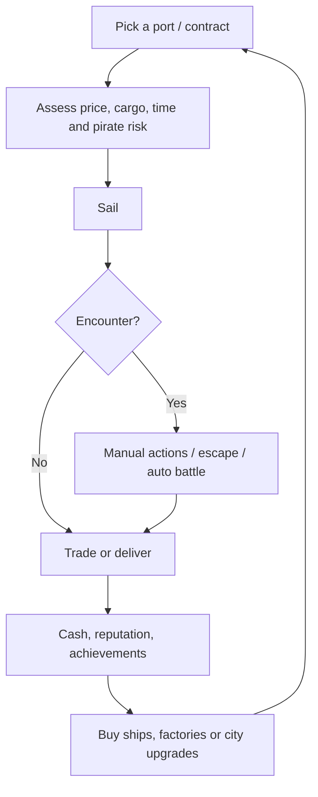

# Game design: meaningful choices, minimal chores

## Core loops

## Four balancing tensions

1. **Risk vs reward:** routes trade estimated gross margin against exposure to pirate zones and opportunity cost.
2. **Manual vs passive income:** enterprises auto-sell but reserved goods and price floors leave a reason to sail.
3. **Capital deployment:** ship, warehouse, factory and city projects compete for the same treasury.
4. **Freedom vs goals:** explore without a timer, yet chase ranks, achievements and three ending paths.

## Core player-driven design decisions

- One active ship; no fleet-management chore.
- Permit up to ten goods per port although the original PC game imposed production specializations.
- Show quantitative combat/escape estimates, clearly forecasts rather than certainties.
- Make governor contracts simple to accept *with goods*, not merely add an obligation.
- Auto-sale is bounded by town demand, stock capacity and price floor rather than infinite cash printing.

[Economy and simulation](../data-economy/README.md) · [Career](progression.md) · [Original research](../research/README.md)
