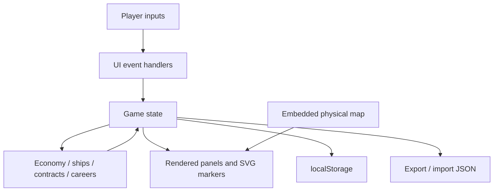

# Web engineering: one file, no infrastructure

**Runtime:** browser-based HTML + CSS + vanilla JavaScript. No account, backend, external API, build service or third-party runtime dependency is required to play.

## Engineering concerns

- **Portability:** imagery, CSS and JavaScript embedded in the public standalone HTML.
- **Persistence:** localStorage save and explicit JSON backup to move between local file versions.
- **Migrations:** existing factory data adapted to a per-product ledger with historical resources retained.
- **Atomic actions:** contracts and mass constructions verify funds/space/stock before mutation.
- **State observability:** market / ship / current port / achievements are available in the UI.
- **Offline-first:** no login, no external data fetch required for gameplay.

## What this demonstrates

A lightweight single-page interactive application with business rules, localization and real user feedback — not a claim of large-scale infrastructure or production hosting.

[Play v1.0](../play/README.md) · [State model](../data-economy/README.md) · [QA evidence](../testing/evidence.md)
