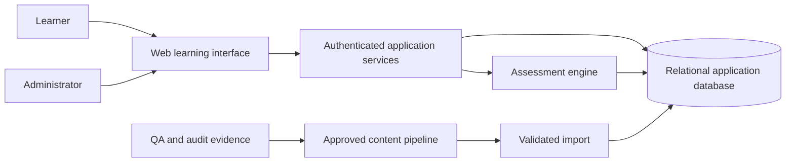
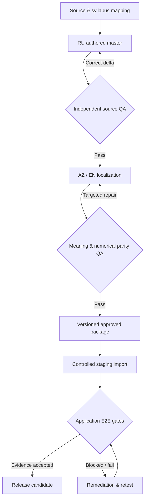
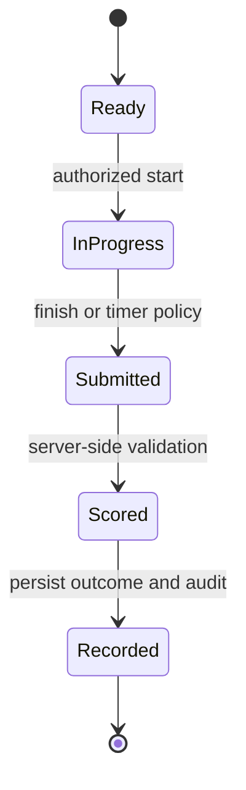

# Examinations Platform — Generalized Architecture

This is a **conceptual, privacy-safe architecture** of the proposed platform, not a deployment diagram or a copy of private system configuration.

## 1. System context

**Main responsibilities**

- **Web interface:** study navigation, progress and assessment presentation.
- **Application services:** identity, authorization, state transitions and data access.
- **Assessment engine:** attempt lifecycle, server-side answer validation and scoring.
- **Content pipeline:** controlled source → review → localization → approval → import.
- **Evidence layer:** parity checks, source references, regression tests and release gates.

## 2. Content workflow

Different stages have different meaning: source validation, translation parity, staging integration and production release are **separate acceptance gates**.

## 3. Examination attempt lifecycle (illustrative)

Practice and strict examination are distinct modes in the planned product model. Exact commercial/internal security policy and unreleased runtime details are intentionally omitted.

## 4. Principles

1. Stable IDs across multilingual variants.
2. Protected canonical assessment content; controlled promotion only.
3. No answer-key disclosure before an assessment ends.
4. Server-side authoritative validation and persistence.
5. Least-privilege access and privacy-aware aggregates.
6. Explicit reconciliation and reproducible QA artifacts.

These are architectural principles and acceptance criteria; not an assertion that every runtime control is live.
