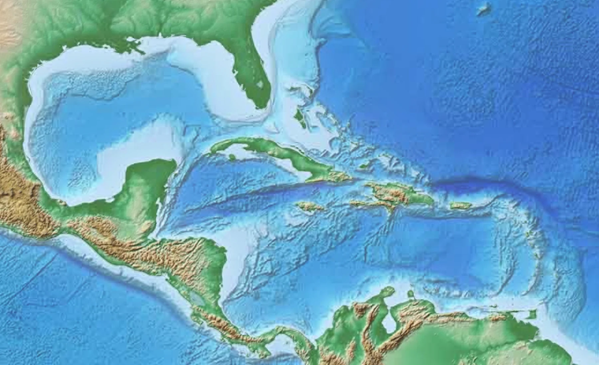
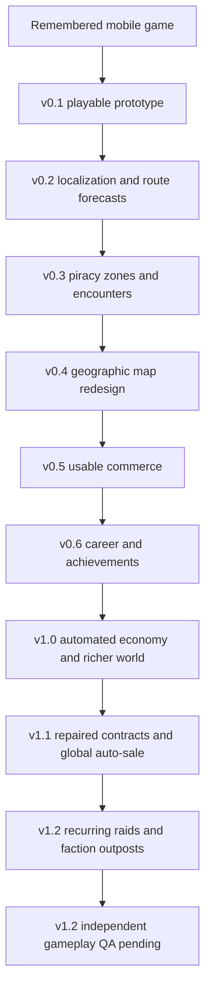

# Caribbean Merchant
### From a childhood mobile-game memory to a playable Caribbean strategy

**Independent fan-inspired project · Current documented release v1.1; latest identified HTML v1.2 (gameplay QA pending) · RU / EN / AZ**

> I remembered a mid-2000s mobile game: trading between Caribbean ports, dodging pirates, growing a business and fighting tactical sea battles. Years later, I set out to rebuild that *feeling*, one remembered feature and one playtest at a time — without copying the original game.

**[Latest identified HTML v1.2](releases/CaribbeanMerchant_v1.2.html)** · [Current documented v1.1](play/CaribbeanMerchant_v1.1.html) · [Previous v1.0](play/CaribbeanMerchant_v1.0.html) · [How to run and migrate saves](play/README.md) · [v1.1 QA report](testing/v1.1-contracts-autosale.md)

*Physical terrain used in the game (NOAA ETOPO / Basemap processing). The live browser game overlays ports, piracy zones and routes on this geography.*

## The story

The initial reference was **Port Royale 2 Mobile (Elkware / Java era, mid-2000s)**. The project began with fragments of personal recollection — ports, trading, pirates and ship combat — not an original JAR, source archive or extracted artwork.

We turned those recollections into a small working browser prototype. I tested it as a player, reported practical friction and adjusted the requirements: the unreadable first map, hidden cargo and cash during scrolling, repetitive factory collection, slow contracts and a lack of meaningful late-game goals. The browser game evolved through **seven preserved pre-v1.1 build milestones** and many design, feedback and QA cycles.

**My role:** concept originator, product owner, gameplay critic and hands-on user tester; feature prioritization and acceptance feedback. **AI-assisted implementation:** ChatGPT helped research mechanics, write and iterate code, prepare documentation and execute scripted browser checks. This is an honest solo-owner/AI-assisted workflow, not an invented studio team.

## Playable result

The following baseline capabilities were introduced by v1.0 and remain in v1.1.

| Area | Baseline features retained in v1.1 |
|---|---|
| World | 15 Caribbean ports, 4 colonial nations, physical relief map |
| Trade | 10 goods, changing stock/price, quantity-aware bulk transactions |
| Management | Up to 10 factories per city, auto-sale, reserves, price floors, upgrades to 300 units per product |
| Player experience | Sticky treasury/cargo HUD, contextual market actions, one-click contracts |
| Naval game | One controllable ship, ship upgrades, manual turn-based fights and auto-resolve |
| Progression | 16 ranks, 82 achievements, 3 victory paths, city buildings |
| Exploration | Pirate zones, named hideouts, treasure fragments and simplified diplomacy |
| Localization | Russian, English, Azerbaijani with instant switching |
| Save | Local browser storage plus JSON export/import |

### v1.2 artifact and provenance

The 506,270-byte self-contained HTML provided in the project chat is preserved byte-for-byte under `releases/` (SHA-256 `e70f0c6a91177dd630a81e695adc2475f81e4a23152e7b381e8528a77efd4b1e`). It adds a living world: recurring pirate and faction outposts, raids and city threats, and repeated encounters, as identified in its source. No separate v1.2 source tree or independent gameplay/browser QA report was found. **v1.2 is the latest verified artifact; v1.1 remains the current documented release until v1.2 QA is completed.** [Status and QA](STATUS.md).

### v1.1 additions and fixes

- Expired governor offers rotate instead of blocking contract progression; imported old saves refresh their stale offers.
- New priority contracts pay enhanced rewards. Accepted delivery cargo is loaded consistently, with a one-click completion action at the destination.
- Empire-wide industry auto-sale presets **0% / 75% / 100%** update factories in all cities while preserving reserve and price-floor settings.
- Clearer **Port Governor** requirements to designate a capital before constructing a Personal Palace.
- The release keeps RU / EN / AZ; visible browser title and footer now reflect **v1.1**.

**Quality evidence:** the historical v1.0 report records 26/26 local Chromium/Playwright scenarios. The v1.1 development report separately records 19 synthetic-DOM gameplay assertions, 14 assertions with an actual previously provided save in synthetic runtime, and 5 synthetic UI event assertions as PASS. **Native Windows/Android opening, cross-device save E2E and long-campaign balance were not certified.** [Read the v1.1 report](testing/v1.1-contracts-autosale.md).

The game is **self-contained HTML**. Download it and open it locally. No installation, account, server or gameplay connection is required.

## Explore the case study

| Discipline | What we learned | Evidence and decisions |
|---|---|---|
| **Product & narrative** | Recovering a remembered gameplay loop and scoping it deliberately | [History](history/README.md) · [Feedback → changes](history/feedback-loop.md) |
| **Game design** | Trade, progression, combat, passive economy, game balance | [Game design](game-design/README.md) |
| **UI/UX & visual design** | An unreadable schematic map replaced with geographical relief; compact market UX | [Visual design](ux-ui/README.md) |
| **Web engineering** | Offline vanilla JS, embedded assets, event-driven UI | [Architecture](web-development/README.md) |
| **Data & economics** | Port–good grain, stock reconciliation, safe save migration | [Data model](data-economy/README.md) |
| **Web & game testing** | Browser scenarios, manual playtesting, negative tests, regression gates | [Testing](testing/README.md) |
| **Original research** | Separate Java and PC source claims; protect IP and credit map data | [Research](research/README.md) |
| **Decisions & roadmap** | User-centered constraints and unfinished ideas | [Decisions](project-management/decisions.md) · [Roadmap](project-management/roadmap.md) |

## How the project changed

[**Browse every preserved HTML milestone**](history/releases/README.md) and the [feature-by-feature history](history/milestones.md). **v1.2 is the latest identified standalone HTML; v1.1 is the current documented playable version with historical synthetic QA.** v1.2 gameplay/browser acceptance remains untested; see [status](STATUS.md).

## Links to the wider portfolio

- [Quality Engineering Lab](https://github.com/KonstantinOreshnikov/web-testing-page-object) — reusable E2E/QA learning.
- [Web Testing with Python](https://github.com/KonstantinOreshnikov/web-testing-python) — browser UI and test design.
- [Git Collaboration Guide](https://github.com/KonstantinOreshnikov/git-instruction-workshop) — change control and review.
- [Python Learning Lab](https://github.com/KonstantinOreshnikov/python-lessons-geekbrains) — analysis and validation.
- [Project showcase](../../README.md) — other independent projects.

## What this project is *not*

Not an official Port Royale product, a decompiled/remastered copy, a replacement for the original, or evidence of a full production studio. The original brand belongs to its respective owners. The code, UI and gameplay are independently created; no proprietary original game code or artwork is included. **Public visibility is not an open-source license grant.** See [Attribution and distribution](research/attribution.md).

**Verification boundary:** v1.0 and v1.1 have separate historical QA reports; neither proves a long campaign, native Windows/Android local-file smoke testing, a security audit or statistically sound game balance.

---

**RU · История проекта:** небольшая самостоятельная игра, воссозданная по воспоминаниям о мобильной стратегии середины 2000-х. Работа шла через личные игровые тесты, переделку карты, UX-правки, экономику, морские бои и достижения. Это авторский эксперимент с AI-assisted разработкой, а не копия исходного продукта.
