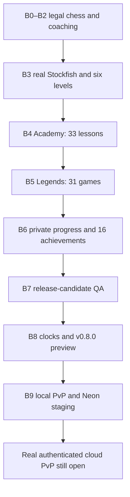

# Chess Odyssey — Academy, Arena & Legends

[**Play Chess Odyssey v1.0.0**](https://konstantinoreshnikov.github.io/KonstantinOreshnikov/chess-odyssey/) · [**Windows / Stockfish ZIP**](https://github.com/KonstantinOreshnikov/KonstantinOreshnikov/actions/runs/45250410329/artifacts/14857182056) · [Release notes](docs/RELEASE_V1_0_0.md)

**Public v1.0.0 — 24 November 2026.** Chess learning for RU/EN/AZ: 33 interactive Academy lessons, 300 historical games (31 fully annotated + 269 historical scores), six AI levels, Stockfish reviews, 10 board themes and 10 piece styles.

| Module | What's included |
| --- | --- |
| Practice & Academy | Lesson navigation beside the board, modes, hints, timers and AI |
| Masters & Legends | Full replay with era/collection filters and historical source attribution |
| My Progress | Email + OTP account UI and server progress; **two-device conflict E2E still open** |
| Play a Friend | Invite-based PvP UI; **live 2-user/third-user security E2E still open** |

[Automated QA: 3/3 PASS](https://github.com/KonstantinOreshnikov/KonstantinOreshnikov/actions/runs/45250410329) · [Independent public smoke: PASS](https://agent.tinyfish.ai/runs/ad1e13fb-00f5-4e26-a235-cd9013ae371d) · [Known risks and rollback](docs/RELEASE_V1_0_0.md) · [Post-release QA register](docs/POST_RELEASE_QA_V1_0_0.md). Released on public GitHub Pages at the owner's explicit direction; the cloud provider continues to use an existing staging Neon backend, without claiming a separately verified production-isolated cloud service.

---

## Historical checkpoint: v0.9.0 development (2026-11-23; superseded)

- **Newest code on `main`:** P0–P2 via [merged PR #18](https://github.com/KonstantinOreshnikov/KonstantinOreshnikov/pull/18), merge commit `a81c5132e6bf0570744720551e857ec2f5f432c9`. Global RU/EN/AZ UI, non-destructive SAN replay, 10 board themes and 10 piece appearances, wide/fullscreen view, depth-aware Stockfish postgame analysis with arrows, per-side denominators and legend.
- **Downloadable v0.9.0 DEVELOPMENT preview:** [46-file ZIP (GitHub Actions artifact)](https://github.com/KonstantinOreshnikov/KonstantinOreshnikov/actions/runs/45126130111/artifacts/14796195974). Internal ZIP SHA-256 `64a75e7fe2d95adf66207207882adae1c146817d4aefe6f58bc4679d29877bf1`, outer archive SHA-256 `c0283f72b4a7c820ccad17fc1f9f4bbc54b423d13ef7c4404a718e129fe17a92`; archive expires **2026-12-23**. GitHub `main` retains the versioned source and reproducible build scripts, but not the v0.9.0 binary ZIP.
- **Executable evidence:** [Post-merge `main` CI 3/3 PASS](https://github.com/KonstantinOreshnikov/KonstantinOreshnikov/actions/runs/45126130111); [P0–P2 Chess QA 3/3 PASS](https://github.com/KonstantinOreshnikov/KonstantinOreshnikov/actions/runs/45125453080) (27/27 new Node UX, 16/16 new real Chromium UX, Windows Stockfish/WASM and historical regressions); studio smoke 1/1 PASS. [Post-merge `main` CI 3/3 PASS](https://github.com/KonstantinOreshnikov/KonstantinOreshnikov/actions/runs/45126130111) on the merged source.
- **Historical rollback:** `releases/ChessOdyssey_v0.8.0_Stockfish_Preview.zip` is preserved in the Git repository (original 42-file ZIP, SHA-256 `3bac88d0d34bcf41fdaedb4b63e482398e6f850c5ba183f2d15bf0e07fcb3395`).
- **NOT production-ready:** real Neon authenticated two-person PvP and persistent authorized game API, owner Android/PC UAT, human RU/EN/AZ educational QA and all 100 visual theme/piece combinations remain OPEN. No production deploy or Neon DB changes.

## B9 / v0.9 Development — source now on main, local PvP + Neon staging (not a published online service)

**The product is built, not conceptual.** Working local application: chess from beginner through six AI levels with Stockfish, 33 interactive RU/EN/AZ Academy lessons, 31 fully replayable historic master games and private progression/achievements. **B8 clock feature set is implemented and automated QA PASS**, but independent human review is still open.

**B9 delivered in source:** separate local authoritative chess match module (`pvp/match-service.cjs`), synthetic loopback HTTP/API (`pvp/dev-server.cjs`) and demo UI, private invites, alternating legal moves, canonical PGN/FEN, two clocks, resign/draw/rematch/reload. **27/27 domain + 15/15 HTTP + 11/11 real two-context Chrome synthetic PvP PASS** in [CI #403](https://github.com/KonstantinOreshnikov/KonstantinOreshnikov/actions/runs/44893035027). **WARNING:** `X-Demo-User` in this local-only fixture is spoofable; never deploy it publicly. Cloud multiplayer is NOT tested.

**Neon staging actual state:** connected Free organization; isolated project `Chess Odyssey — Staging`, PostgreSQL 17 Frankfurt; four application tables created with RLS+FORCE RLS and zero allow policies; Better Auth enabled with password + mandatory email OTP, password-reset session revocation; 9 auth tables, 0 actual users/games at last verification. **Real two-user signup/login, persisted game API, token validation, negative access/security E2E, host and production not ready.** See [live Neon staging checkpoint](docs/B9_NEON_STAGING_CHECKPOINT_2026-11-21.md) and [B9 technical contract](docs/B9_NEON_INTEGRATION.md).

**Status discipline:** phase `v0.9` != validated downloadable `v0.9` artifact. Continue using v0.8.0 preview to play locally. B8 human language/source and owner device checks remain open. PvP with real cloud accounts is a v1.0 blocker.

## B8 playable clock preview (v0.8.0; included in B9 working branch)
- **Clock presets:** Untimed (default); Bullet 1+0; Blitz 3+0 and 5+0; Rapid 10+0, 15+0, 15+10, 20+0 and 30+0; Custom. Clocks run separately and include AI thinking time. Each completed move earns the chosen increment. Clock flags and resignation conclude the game without inventing checkmate in the PGN.
- **Display:** optional hourglass animation beside exact digital numbers, optional local synthesized sounds, rematch/resign actions and RU/EN/AZ time controls. B2 postgame analysis remains available.
- **Integrity:** timed AI matches do not enter the existing uncalibrated AI Ladder Index; existing untimed no-assistance verification remains unchanged. Offline standalone still plays against the local weaker AI when file:// lacks Stockfish Worker support.
- **Current post-merge main QA:** [CI #407](https://github.com/KonstantinOreshnikov/KonstantinOreshnikov/actions/runs/44901266865), **3/3 jobs SUCCESS** on `main`: 32/32 B8 clock, 12/12 B8 real Chrome, 27/27 B9 domain, 15/15 B9 synthetic HTTP, 11/11 B9 two-Chrome, historical B0–B7 and native Windows launcher. Playable **v0.8.0** 42-file ZIP from #407 SHA256 `3bac88d0d34bcf41fdaedb4b63e482398e6f850c5ba183f2d15bf0e07fcb3395` ([GitHub artifact](https://github.com/KonstantinOreshnikov/KonstantinOreshnikov/actions/runs/44901266865/artifacts/14705809423)). Prior developer-branch #403 and B8-only #372 hashes remain historical.
- **Open:** independent human RU/EN/AZ educational semantics, physical PC/phone testing, historical second-source verification and bounded extra openings; B9 persistent authenticated Neon multiplayer and real E2E; B10 final release. Neon Auth provisioned is NOT equal to an integrated live game.

## What is playable

**Tab 1: Practice & Academy.** Play a full game with Beginner, Novice, Intermediate, Advanced, Expert, or Grandmaster Challenge AI presets. The four stronger settings use the **genuine Stockfish 19 Lite WASM** in a local HTTP-served package; if its Worker is unavailable the UI clearly labels a weaker fallback. B2 Coach gives shallow, legal two-ply hints in **Coached Practice**. The existing **33 original RU/EN/AZ chess exercises** across 9 Rules, 8 Tactics, 8 Openings (White and Black) and 8 Endgames are fully playable. Learned lessons, step position and parked practice session remain saved.

**Tab 2: Masters & Legends.** Explore **31 complete historical move scores** (1834–2013, 1,923 verified legal half-moves) with **116 original RU/EN/AZ explanatory critical moments**. The independent historical chessboard has selectable SAN timeline, step/slider/autoplay controls, search/filter, legal "Guess the historical move" quizzes, source hyperlinks, PGN download and bookmarks. Winning by recorded resignation is **never incorrectly labelled a played checkmate**. The score source/cross-check provenance and limits are documented in `docs/MASTERS_B5_SOURCE_REGISTER.md`.

**Tab 3: My Progress — NEW B6.** Real completion and learning achievements without fabricated chess strength:

| Measure | Data population and criterion |
| --- | --- |
| **Academy Reputation** | Unique completed lessons (20 points each), historical key positions actually studied (4 each), correctly solved unique master quizzes (12 each), complete source-game studies (20 each) and first eligible independent win per AI tier (15 each). No point-farming by repeats |
| **Academy progress** | 33 stable task IDs; four exact topic denominators (9/8/8/8). Older B4/B5 completed IDs automatically count, never double count |
| **Masters studies** | 31 games; complete study requires **all annotated moments + historical final position**; separate distinct count of correctly guessed moves |
| **Achievements** | 16 original RU/EN/AZ milestones; unlocked from actual saved facts, not paid, manually selected, or sourced from fake Elo |
| **AI Ladder Index** | Private 0–100 indication from actual independently played games **against these six bot tiers**, not a FIDE/Elo or externally calibrated player rating |

### How the independent AI index works

By default the game is **Coached Practice**. You can explicitly select **Independent game · no assistance** in the game settings to start a completely new game. During that match, live hints, Coach grading, candidate destination highlights, undo, Academy selection and live review are disabled. **After a completed game**, you may open post-game review freely; the recorded result is already final.

Only a genuinely **completed game played from the ordinary starting position** can enter the independent-match ledger: every move in its PGN is replayed through chess.js, game-over/checkmate or draw is checked, and the winner is determined from the chess position. Matches that used help, Undo, an unexpected weaker AI fallback at Stockfish tiers, invalid/corrupt PGN or a previously counted match ID are excluded. Abandoning or switching the difficulty begins another game and does not register a result. Academy lessons, master quizzes and prior coached wins never become rated.

**Internal index formula**, with full visibility:

```text
score = 1 (win), 0.5 (draw), 0 (loss)
tier  = 1 Beginner, 2 Novice, 3 Intermediate, 4 Advanced, 5 Expert, 6 GM Challenge
AI Ladder Index = round( average(100 × tier/6 × score) over last 20 eligible games )
```

The index is **hidden until at least 5 eligible independent games** exist. From 5–19 games, it is explicitly **provisional**; 20+ means more local data, **not certified confidence or skill calibration**. It is not comparable to Elo, FIDE, Lichess or Chess.com ratings. It measures a personal 0–100 in-game trend against fixed bot tier labels; changing AI builds could alter its meaning.

**Offline-version storage and privacy:** `chess-odyssey-progress-v1` is local to the browser, source-grain separated from old `chess-odyssey-v01` practice/Academy and `chess-odyssey-masters-v1` historic bookmarks. The current downloadable v0.8.0 game does **not** log in to Neon, has no payments or telemetry. Neon Auth staging exists separately but is not yet integrated with this playable client. Clearing browser data clears local scores. Local storage **is not anti-cheat-secure**; never treat the index as a global competitive rating. The retained independent game ledger holds at most 500 entries, and can no longer mean literal all-time beyond that cap.

## How to play

**Newest v0.9.0 development preview with Stockfish:** [Download GitHub Actions package](https://github.com/KonstantinOreshnikov/KonstantinOreshnikov/actions/runs/45126130111/artifacts/14796195974) (retained until 2026-12-23). Extract the inner ZIP and run `START_WINDOWS.cmd` on Windows for genuine local Worker/WASM. Source/build scripts persist on `main`. **Older v0.8.0 instructions below are for rollback.**

**Historical v0.8.0 full package:**

1. Open [verified main-branch CI #407](https://github.com/KonstantinOreshnikov/KonstantinOreshnikov/actions/runs/44901266865); the downloadable playable binary in Artifacts is still **v0.8.0**, not v0.9.
2. In the **green, successful v0.8.0** run, open *Artifacts*, download `ChessOdyssey-v0.8.0-B8-Development-Stockfish-PREVIEW`, and extract the ZIP.
3. On Windows double-click `START_WINDOWS.cmd` (Python 3 or Node.js required) to open the locally hosted game at `http://127.0.0.1:8765/index.html`. A physical Windows host test remains a v1.0 gate.

Alternatively, from the extracted folder:

```sh
python -m http.server 8765 --bind 127.0.0.1
# or
node scripts/serve-local.cjs
```

**Offline one-file in the latest #407 ZIP:** `dist/ChessOdyssey_v0.8.0_PREVIEW.html` contains *all* Practice, Academy, Masters and Progress features without a server or internet. The four stronger Stockfish tiers fall back visibly to a weaker local engine because a file://-loaded HTML cannot run the licensed WASM Worker correctly. **Such fallback games are ineligible for the independent AI index.**

## Historical B7 Release Candidate — automated gates and honest constraints (not current development phase)

**[Final documentation-synchronized three-job GitHub Actions run #339](https://github.com/KonstantinOreshnikov/KonstantinOreshnikov/actions/runs/44883137898)**:

- **237/237 runnable Node and real Chrome automated cases PASS** (previous 180 from B0–B6, 22 B7 legal/rules/integrity cases, 27 B7 desktop/mobile/promotion/keyboard cases, one *genuinely played* full human-move-vs-AI match via real Stockfish UCI, and seven WCAG 2.2 axe scans). **Windows runner launcher + licensed Stockfish archive smoke 1/1 PASS**, so **238/238 including Windows gate**.
- **Real full game:** separate real Stockfish computes user moves against the built-in actual Beginner bot, and the test clicks each move through the normal browser UI from the **standard starting position**, with no seeded PGN. Final #339 run ended after **55 real half-moves** in checkmate (earlier independent green #328 also ended at 21 plies), was recorded only once as an independent result, and survived reload without changing the score.
- **Controls and UX:** all practice-board cells support arrow-key navigation, Enter/Space moves and localized piece speech labels in Russian, English and Azerbaijani; the pawn-promotion modal captures focus, cycles with Tab, cancels with Escape and returns focus to the actual square. Historical read-only board uses non-interactive visual cells rather than dozens of dead buttons. Tabs navigate by ArrowLeft/ArrowRight/Home/End.
- **Accessibility:** six real Chrome axe checks (3 tabs × desktop/mobile) plus the real promotion modal detected **zero WCAG A/AA violations** under the automated rules. This does **not** assert fully independent human screen-reader or WCAG conformance certification.
- **Source truth:** on 2026-11-21 all **31 exact historical source pages** were re-fetched and checked: **1,923/1,923 SAN moves, player names, years and results** match the registered primary pages. Independent cross-archive full proof remains limited and disclosed in `docs/SOURCE_B7_REFRESH.md`.
- **Security/integrity:** independent AI matches are now only admitted if the exact final PGN can be replayed **in full from the normal initial position**. Composed custom-FEN terminal PGNs are excluded from the local AI index.
- **Packaged:** full versioned **40-file** source-inclusive GPL Stockfish v0.7.0 ZIP (internal SHA256 **`bb9fa7b525f320ce50fdc0465ca63c5eac2d91807cc234f914bb9f5fafa37d94`** from #339), plus complete self-contained HTML. The original Stockfish WASM is included unmodified, and the offline file falls back to weak local AI, explicitly labelled.

**Historical B7 release boundary:** At the earlier v0.7.0 RC checkpoint, neither `main` nor production had been changed. **Later, on 2026-11-21, owner-approved PR #7 merged source into `main`, while production remained untouched.** FIDE official laws treat threefold repetition as a claimable draw; this coaching app auto-adjudicates it in accordance with the existing pinned chess.js simplification. Independent human RU/EN/AZ pedagogical proofreading, manual assistive-technology audit, historical second-source adjudication for remaining parties and the owner-approved deployment location are **NOT DONE / OPEN**, so **v1.0 remains BLOCKED**.

## Evidence, source and licensing

- **B6 technical and measurement authority:** `docs/PROGRESS_B6_DESIGN.md` and exact original executable `progress-core.js` (pure progress+match verification), `progress-ui.js` (three-language display and persistence). B6 Node methodology tests: `tests/progress-content.cjs`; real browser integration: `tests/progress-browser.cjs`.
- **Full prior baseline:** B5 `docs/MASTERS_B5_DESIGN.md` + historical source register and factual scores, B4 `docs/ACADEMY_B4_DESIGN.md`, B3 `docs/ENGINE_B3_DESIGN.md`, B2 coach design and unchanged B0/B1 chess.js rules. `docs/QA_LOG.md` contains exact PASS/FAIL evidence, hashes, regression status and source conflicts.
- chess.js **v0.10.3 BSD-2-Clause**, original license retained in `vendor/chess.js`. Genuine **Stockfish.js v19.0.1 Lite GPLv3** source https://github.com/nmrugg/stockfish.js/tree/v19.0.1, unmodified binary in `engine/*`, GNU GPLv3 text `engine/Copying.txt`, binary SHA256 in `engine/MANIFEST.md`; `THIRD_PARTY_NOTICES.md` attributes components. No proprietary third-party game commentary was copied.
- Follow Reuse First, Unlazy QA, Humanizer and Translation QA; historical source provenance and RU/EN/AZ semantic parity are held to explicit gates, never certified without evidence.

**Release boundary:** the historical B7 v0.7.0 candidate passed automated QA, B8 clock feature QA and B9 local PvP QA have since passed separately. **Current stage is B9/v0.9 development, NOT a v0.9 shipped binary.** Owner signoff, authenticated Neon cloud PvP, production hostname/deploy and independent human editorial/accessibility certification remain **BLOCKED / NOT TESTED**. **Source code merged into `main` under explicit owner authorization (PR #7); no production deployment or v1.0 release.**

## How the project changed



| Stage | Preserved artifact / evidence | What it means now |
| --- | --- | --- |
| **B0–B2 · v0.1, v0.1.1, v0.2.0, v0.2.1** | [Archived preview HTML builds](dist/) · [full change history](CHANGELOG.md) | Legal chess, beginner practice, coaching and postgame review; historical development previews. |
| **B3 · v0.3.0** | [Stockfish preview](dist/ChessOdyssey_v0.3.0_PREVIEW.html) · [QA log](docs/QA_LOG.md) | Genuine Stockfish Worker/WASM at four stronger levels, with explicit offline fallback. |
| **B4 · v0.4.0** | [Academy preview](dist/ChessOdyssey_v0.4.0_PREVIEW.html) · [roadmap](docs/ROADMAP.md) | 33 RU/EN/AZ lessons across rules, tactics, openings and endgames. |
| **B5 · v0.5.0** | [Masters preview](dist/ChessOdyssey_v0.5.0_PREVIEW.html) · [source register](docs/MASTERS_B5_SOURCE_REGISTER.md) | 31 replayable historical games and 116 original key moments. |
| **B6 · v0.6.0** | [Progress preview](dist/ChessOdyssey_v0.6.0_PREVIEW.html) · [design](docs/PROGRESS_B6_DESIGN.md) | 16 achievements, learning progress and private AI Ladder Index. |
| **B7 · v0.7.0 RC** | [Candidate preview](dist/ChessOdyssey_v0.7.0_PREVIEW.html) · [238/238 historic QA](docs/RELEASE_B7_QA.md) | Automated release-candidate gates passed; independent human acceptance remained open. |
| **B8 · v0.8.0 preview** | [Last packaged playable ZIP](releases/ChessOdyssey_v0.8.0_Stockfish_Preview.zip) · [main CI #407](https://github.com/KonstantinOreshnikov/KonstantinOreshnikov/actions/runs/44901266865) | Playable clocks and Stockfish; 3/3 CI jobs PASS, manual/device review open. |
| **B9 · v0.9 development** | [Current source and staging status](docs/CURRENT_STATUS.md) · [Neon checkpoint](docs/B9_NEON_STAGING_CHECKPOINT_2026-11-21.md) | Local synthetic PvP and isolated Auth/database staging. **No v0.9 packaged release; no real authenticated cloud match verified.** |

The earlier previews are retained as development history. The B9 stage is source development, while v0.8.0 remains the last packaged playable preview; [v1.0 gates](docs/ROADMAP.md) are still open.
