# Chess Odyssey — Development history, feedback and defect register

**Current web version: v1.1.3 — deployed production UAT candidate (25 November 2026).** [Play](https://konstantinoreshnikov.github.io/KonstantinOreshnikov/chess-odyssey/) · [PR #31](https://github.com/KonstantinOreshnikov/KonstantinOreshnikov/pull/31) · [Focused QA 24/24](https://github.com/KonstantinOreshnikov/KonstantinOreshnikov/actions/runs/45670474986) · [Full regression 3/3](https://github.com/KonstantinOreshnikov/KonstantinOreshnikov/actions/runs/45670473640) · [Production Pages 3/3](https://github.com/KonstantinOreshnikov/KonstantinOreshnikov/actions/runs/45673333733). Practice HUD parity with PvP: side clocks, turn, captured pieces, last move, replay-aware information and thinner arrows. Real production UAT, latency and independent human/device acceptance remain open. Latest permanent prerelease v1.1.1; latest non-prerelease tagged package v1.1.0. v1.1.3 ZIP is a verified temporary CI artifact. No server, database or security-policy change.

[Practice HUD feedback and QA](PRACTICE_HUD_V1_1_3.md).

**Historical v1.1.2 production deployment checkpoint (25 November 2026; superseded).** [Play](https://konstantinoreshnikov.github.io/KonstantinOreshnikov/chess-odyssey/) · [PR #28](https://github.com/KonstantinOreshnikov/KonstantinOreshnikov/pull/28) · [Focused QA 24/24](https://github.com/KonstantinOreshnikov/KonstantinOreshnikov/actions/runs/45624812948) · [Full regression 3/3](https://github.com/KonstantinOreshnikov/KonstantinOreshnikov/actions/runs/45624812883) · [Production Pages 3/3](https://github.com/KonstantinOreshnikov/KonstantinOreshnikov/actions/runs/45627594965). Real v1.1.2 two-player UAT, measured production latency and full human/device acceptance remain open. Latest permanent package is [v1.1.1 prerelease](https://github.com/KonstantinOreshnikov/KonstantinOreshnikov/releases/tag/chess-odyssey-v1.1.1); latest non-prerelease tagged package is [v1.1.0](https://github.com/KonstantinOreshnikov/KonstantinOreshnikov/releases/tag/chess-odyssey-v1.1.0). v1.1.2 ZIP is a verified temporary CI artifact, not a permanent GitHub Release.

This is the consolidated public engineering history, derived from the original concept, preserved version artifacts, [changelog](../CHANGELOG.md), [QA ledger](QA_LOG.md), [roadmap](ROADMAP.md), Git commits and PRs, historical release notes and actual owner/colleague playtest feedback. Dates use Asia/Baku for project milestones; GitHub UTC timestamps may fall on the preceding date. Historical PASS is scoped and preserved; a deployment PASS is not user acceptance. No personal details or private game records are reproduced.

## Evolution map

```mermaid
flowchart TD
 A["20 Nov: original learning-first concept"] --> B["B0–B1 · v0.1 / v0.1.1 · legal chess, practice"]
 B --> C["B2 · v0.2.0 / v0.2.1 · Coach"]
 C --> D["B3 · v0.3.0 · Stockfish"]
 D --> E["B4 · v0.4.0 · 33 Academy lessons"]
 E --> F["B5 · v0.5.0 · 31 Legends games"]
 F --> G["B6 · v0.6.0 · progress, achievements"]
 G --> H["B7 · v0.7.0 · release-candidate QA"]
 H --> I["B8 · v0.8.0 · clocks, sound, replay"]
 I --> J["B9 · v0.9.0 · local PvP / Neon staging"]
 J --> K["P0–P2 · trilingual UI, themes, review"]
 K --> L["v1.0.0 · 300 games, cloud progress, public release"]
 L --> M["v1.1.0 · friend invites, Login, text zoom"]
 M --> N["Real PvP feedback: stalls, F5, localization"]
 N --> O["v1.1.1 · sync and recovery hotfix"]
 O --> P["Real playtest: playable, residual lag, UX feedback"]
 P --> Q["v1.1.2 · HUD, captures, result, review, Practice layout"]
 Q --> R["Production UAT candidate deployed · automated PASS"]
 R --> T["Practice feedback: clocks, turn, captures, replay convenience"]
 T --> U["v1.1.3 · Practice HUD parity, thinner arrows"]
 U --> V["v1.1.3 deployed · automated QA PASS"]
 V --> S["Open: real production acceptance and latency"]
```

## Version-by-version delivery

| Version / stage | Delivered | Evidence / state |
| --- | --- | --- |
| Concept · 20 Nov | Board-first beginner learning, no pressure, separate practice, historical games, contextual coaching | [Original concept](ORIGINAL_CONCEPT_2026-11-20.md) — historical idea |
| v0.1 / v0.1.1 · B0/B1 | Legal chess.js rules, legal moves, undo, AI, three lessons, RU/EN/AZ, local saves; park/return to practice and correct terminal accounting | [Previews](../dist/) · QA #21: 12 rules + 7 DOM + 10 Chromium PASS |
| v0.2.0 / v0.2.1 · B2 | 2–3 candidate moves, threat explanations, short reply analysis, postgame learning moments | [Coach design](COACH_B2_DESIGN.md) · QA #73 21/21 Chromium; repaired rendering |
| v0.3.0 · B3 | Six profiles, real Stockfish 19 Lite WASM, explicit offline fallback, localhost Windows launcher and GPL provenance | [Engine](ENGINE_B3_DESIGN.md) · QA #112 75/75 |
| v0.4.0 · B4 | 33 lessons, four tracks, 49 learner moves, scripted replies and RU/EN/AZ | [Academy](ACADEMY_B4_DESIGN.md) · [99/99](https://github.com/KonstantinOreshnikov/KonstantinOreshnikov/actions/runs/44824986016) |
| v0.5.0 · B5 | 31 full-score historic games, 1,923 legal plies, 116 original annotated moments, replay/search/quiz/export | [Sources](MASTERS_B5_SOURCE_REGISTER.md) · QA #206 135/135 |
| v0.6.0 · B6 | 16 achievements, non-farmable reputation, private AI Ladder Index (not Elo), saved learning progress and migrations | [Progress design](PROGRESS_B6_DESIGN.md) · [180/180](https://github.com/KonstantinOreshnikov/KonstantinOreshnikov/actions/runs/44845418646) |
| v0.7.0 · B7 | Full rules, actual Stockfish match, keyboard/promotion, accessibility, packaging; candidate gates | [238/238 and Windows](RELEASE_B7_QA.md), human review open |
| v0.8.0 · B8 | Untimed/timed presets, authoritative local elapsed time, hourglass/sounds, resign/rematch and saves | [Archived ZIP](../releases/ChessOdyssey_v0.8.0_Stockfish_Preview.zip) · [main #407](https://github.com/KonstantinOreshnikov/KonstantinOreshnikov/actions/runs/44901266865) |
| v0.9 development · B9 | Local private invite/accept, legality, clocks, persistence, two browser fixtures; Neon staging Auth/DB | [B9 checkpoint](B9_NEON_STAGING_CHECKPOINT_2026-11-21.md) · [#407](https://github.com/KonstantinOreshnikov/KonstantinOreshnikov/actions/runs/44901266865) local domain 27/27, HTTP 15/15, dual-Chrome 11/11 |
| v0.9.0 · P0–P2 | Global language, read-only replay, ten board themes / ten piece appearances, wide view, depth-aware Stockfish analysis | [PR #18](https://github.com/KonstantinOreshnikov/KonstantinOreshnikov/pull/18) · [main 3/3](https://github.com/KonstantinOreshnikov/KonstantinOreshnikov/actions/runs/45126130111) · [temporary 46-file preview](https://github.com/KonstantinOreshnikov/KonstantinOreshnikov/actions/runs/45126130111/artifacts/14796195974) |
| v1.0.0 · 24 Nov | 300 historical scores (31 annotated, 269 sourced), 33 lessons, mobile settings, Academy beside board, account-owned autosave, signed API, public Pages | [PR #23](https://github.com/KonstantinOreshnikov/KonstantinOreshnikov/pull/23), [PR #20](https://github.com/KonstantinOreshnikov/KonstantinOreshnikov/pull/20), [release](https://github.com/KonstantinOreshnikov/KonstantinOreshnikov/releases/tag/chess-odyssey-v1.0.0), [CI](https://github.com/KonstantinOreshnikov/KonstantinOreshnikov/actions/runs/45250410329), [Pages](https://github.com/KonstantinOreshnikov/KonstantinOreshnikov/actions/runs/45261953720) |
| v1.1.0 · 25 Nov | Friend-invite flow, header Login, persistent text-only zoom; official Windows archive | [PRs #24](https://github.com/KonstantinOreshnikov/KonstantinOreshnikov/pull/24), [#25](https://github.com/KonstantinOreshnikov/KonstantinOreshnikov/pull/25), [#26](https://github.com/KonstantinOreshnikov/KonstantinOreshnikov/pull/26); [CI](https://github.com/KonstantinOreshnikov/KonstantinOreshnikov/actions/runs/45475469995); [release](https://github.com/KonstantinOreshnikov/KonstantinOreshnikov/releases/tag/chess-odyssey-v1.1.0) |
| v1.1.1 · 25 Nov | First real PvP failure → serialized sync, recovery, bounded requests, idempotent retries, clock and translation fixes | [PR #27](https://github.com/KonstantinOreshnikov/KonstantinOreshnikov/pull/27), [19/19](https://github.com/KonstantinOreshnikov/KonstantinOreshnikov/actions/runs/45561653790), [full CI](https://github.com/KonstantinOreshnikov/KonstantinOreshnikov/actions/runs/45561653763), [Pages](https://github.com/KonstantinOreshnikov/KonstantinOreshnikov/actions/runs/45571962966), [prerelease](https://github.com/KonstantinOreshnikov/KonstantinOreshnikov/releases/tag/chess-odyssey-v1.1.1); real feedback partial improvement |
| v1.1.2 · 25 Nov | Real playtest UX delta: coordinates, turn indicator, captured pieces, last move, finish dialog, both-player Stockfish review, non-sticky Practice replay, RU/EN/AZ and timing diagnostics | [PR #28](https://github.com/KonstantinOreshnikov/KonstantinOreshnikov/pull/28), [24/24](https://github.com/KonstantinOreshnikov/KonstantinOreshnikov/actions/runs/45624812948), [3/3](https://github.com/KonstantinOreshnikov/KonstantinOreshnikov/actions/runs/45624812883), [deployed](https://github.com/KonstantinOreshnikov/KonstantinOreshnikov/actions/runs/45627594965); real acceptance open |
| v1.1.3 · 25 Nov | Practice/AI HUD parity with PvP: clocks, turn, captured pieces, latest move, replay context and thinner arrows | [PR #31](https://github.com/KonstantinOreshnikov/KonstantinOreshnikov/pull/31) · [Focused QA](https://github.com/KonstantinOreshnikov/KonstantinOreshnikov/actions/runs/45670474986) · [full regression](https://github.com/KonstantinOreshnikov/KonstantinOreshnikov/actions/runs/45670473640); full QA PASS; [deployed](https://github.com/KonstantinOreshnikov/KonstantinOreshnikov/actions/runs/45673333733), real UAT open |

## Historical engineering defects and red-to-green trail

The full [QA ledger](QA_LOG.md) remains the detailed record, including failed/cancelled runs. This index groups related issues rather than pretending every failed CI job was a product defect.

| ID | Observed defect or failure | Repair | Evidence / disposition |
| --- | --- | --- | --- |
| HIST-01 | Chess.js board pieces had no square attribute; synthetic test counted coordinates as pieces | Correct board indexing; scope piece selector | v0.1/0.1.1; QA #17→#21 PASS |
| HIST-02 | Browser install unsupported on Ubuntu 26.04 | Pin 24.04 runner | #19→#21 PASS; infrastructure |
| HIST-03 | Lesson exit overwrote parked practice; undo after terminal state affected results | Return-to-game and terminal accounting fix | v0.1.1 QA #21 |
| HIST-04 | Synthetic replaceChildren fixture incorrect; removal of fileRank broke real render | Correct fixture; restore fileRank and rebundle | #54/#68→[ #73](https://github.com/KonstantinOreshnikov/KonstantinOreshnikov/actions/runs/44815318694) PASS; #72 cancelled |
| HIST-05 | Academy English hint too short, terminal opposition FEN, selection stuck after wrong move, PGN assertion wrong, browser install bottleneck | Correct content/FEN and validate; clear selection; fix PGN assertion; use Chrome fallback | #148/#151/#154/#157/#159→[ #166](https://github.com/KonstantinOreshnikov/KonstantinOreshnikov/actions/runs/44824986016) 99/99 |
| HIST-06 | Wrong source links for two historic games; selectors ambiguous across independent boards; invalid First-button test; overbroad URL ban | Correct provenance, scope board, test disabled state, permit cited links but not remote scripts | B5 #197/#199/#204→#206 135/135; source and QA ledger |
| HIST-07 | Progress denominator/points fixture errors; no visible language switch on Progress | Correct sample grain and reward math assertions; synchronized language selector | #244/#246/#248→[ #275](https://github.com/KonstantinOreshnikov/KonstantinOreshnikov/actions/runs/44845418646) 180/180 |
| HIST-08 | Promotion Escape retry, nested interactive accessibility and obsolete label assertion | Restore promotion retry, proper controls and updated test | #312/#314/#316→B7 238/238, Windows |
| HIST-09 | Clock exact-ms and regex assertions too strict | Bounded timing and correct regex | #361/#362/#369→[ #372](https://github.com/KonstantinOreshnikov/KonstantinOreshnikov/actions/runs/44888424604) and #407 PASS |
| HIST-10 | B9 cloud acceptance not established; P0–P2 selector regressions | Local QA plus scoped review/UI repairs; never substitute mock for cloud | [#407](https://github.com/KonstantinOreshnikov/KonstantinOreshnikov/actions/runs/44901266865), [PR #18](https://github.com/KonstantinOreshnikov/KonstantinOreshnikov/pull/18); separate cloud gate |
| HIST-11 | SVG file:// fetch test incompatible; CORS POST preflight, JWT/session-token boundary, invite count/status locale issues | Image decode test, CORS, signed JWT, localized dynamic labels | [SVG QA](https://github.com/KonstantinOreshnikov/KonstantinOreshnikov/actions/runs/45133287865); commits bded2c772 (CORS), 2f5a8d9b2 (JWT), f57241abf (locale) |
| HIST-12 | Local/test progress could leak into new account; hidden/missing controls and postgame review | Account-owned fresh profiles and CAS autosave, board-adjacent Academy, responsive settings, postgame controls restored | [PR #23](https://github.com/KonstantinOreshnikov/KonstantinOreshnikov/pull/23), [v1.0 CI](https://github.com/KonstantinOreshnikov/KonstantinOreshnikov/actions/runs/45250410329); real cross-device conflict open |
| HIST-13 | Four duplicated historical scores, one SAN anomaly, year validator and denominator mismatch | Replace sourced records, correct validator, reconcile 300-game counts, include complete data in Pages | commits 9b0de1de9, f673cf1ca, 368c58816; [v1.0 CI](https://github.com/KonstantinOreshnikov/KonstantinOreshnikov/actions/runs/45250410329) |
| HIST-14 | Pages artifact-metadata race on public release | Bounded artifact index retry/propagation delay | [v1.0 successful deployment](https://github.com/KonstantinOreshnikov/KonstantinOreshnikov/actions/runs/45261953720), [PR #26](https://github.com/KonstantinOreshnikov/KonstantinOreshnikov/pull/26) |
| HIST-15 | Owner requested clearer login, shareable invite, and text-only zoom | Header controls, invitation flow, persisted zoom | [PR #24](https://github.com/KonstantinOreshnikov/KonstantinOreshnikov/pull/24), [CI](https://github.com/KonstantinOreshnikov/KonstantinOreshnikov/actions/runs/45475469995); actual owner login/invite verified, later PvP defects separately tracked |

## Production feedback → fix → retest

| Issue | Actual observation | Implemented change / release | Verification and remaining risk |
| --- | --- | --- | --- |
| BUG-01 | v1.1 EN/AZ untranslated time options and unidentified dialog | v1.1.1 translated presets, promotion, errors, status and accessibility; v1.1.2 new HUD/result/review locale keys | Targeted CI PASS; unknown dialog / full independent editorial acceptance open |
| BUG-02 | Real v1.1 game stalled after 1–2 moves | v1.1.1 single-flight polling, epoch/version guards, bounded requests, same-request-ID retry | 40 half-moves synthetic PASS; real v1.1.1 five-minute match playable, exact initial stall cause and v1.1.2 real acceptance open |
| BUG-03 | v1.1 F5 lost active game | Account-scoped active-game restore and F5 navigation | Both mock browser F5 PASS; actual two-account F5/reconnect not confirmed |
| BUG-04 / PERF-112-01 | Slow sync in v1.1; residual lag in v1.1.1 | Poll 6.5→1.2 s in v1.1.1; v1.1.2 validated PGN cache, redundant clock write reduction, bounded timing metrics | Synthetic read p95 28 ms, move p95 43 ms, render p95 6 ms in one mock run; not network/production latency. Production target remains unverified |
| UX-112-01 | Missing coordinates in PvP | v1.1.2 A–H / 1–8, corrected square colors and flip | Focused coordinates/flip PASS; owner visual check open |
| UX-112-02 | Current turn unclear | Left HUD with both clocks, active color and arrow; responsive layout | Focused absolute turn in 3 locales PASS |
| UX-112-03 | Last move invisible | Server-confirmed from/to highlighting | Both browsers and F5 synthetic PASS |
| UX-112-04 | Missing end-of-game message | Perspective-aware result modal; localized server reason keys | Win/loss and flag-fall fixture PASS; draw/resign/mate reason coverage not fully evidenced in new browser fixture |
| UX-112-05 | No accessible PvP postgame analytics | Completed-game-only Stockfish and read-only replay for both players | Both can open replay; actual engine analysis executed for one fixture; no active-game access. Real two-player review open |
| UX-112-06 | Practice toolbar sticky, too large, misaligned | Normal document flow, compact board-aligned dock | Responsive 1280/390/320 browser alignment PASS |
| UX-112-08 | Require complete RU/EN/AZ | Added all new panel keys, reason/status/controls and aria labels | Targeted 3-language checks PASS; full independent locale sweep open |
| UX-112-09 | Show captured figures by original color, compact repeated counts | Capture chips from canonical history, multiplier ×N | Grouped pawn ×2 and replay fixture PASS; special captures/promotion and actual recovery not exhaustively evidenced |

Source: [v1.1 failure record](POST_RELEASE_UAT_2026-11-25.md) and [v1.1.1 feedback / v1.1.2 requirements](POST_RELEASE_UAT_V1_1_1_2026-11-25.md). The real match report is attributed to owner/colleague testing, not a fabricated independent reviewer. All historical fails remain evidence; implemented is not synonymous with production-verified closed.

## Practice feedback → fix → retest (v1.1.3)

| ID | Owner feedback / requirement | Implementation and scope | Verification |
| --- | --- | --- | --- |
| UX-113-01 | Practice clocks and player information above board use space inefficiently | Desktop left HUD; compact above board on smaller screens, orientation-aware White/Black order; same canonical clock state | Chromium UX 19/19 and clock 12/12 PASS; physical PC/mobile UAT open |
| UX-113-02 | Need clear turn and move information as in PvP | Absolute side to move, active-color arrow, latest SAN with correct side, existing from/to highlight; no active turn at finished position | Practice HUD case 12 PASS; live owner visual acceptance open |
| UX-113-03 | Show captured figures by original color with ×N | Counts derived from verbose history, cut at replay cursor; no material-count guesses; untimed games and lessons retain HUD | Grouped pawn/queen and history cursor fixture PASS; special capture/promotion coverage not exhaustive |
| UX-113-04 | Make review and replay easier | Board and controls share column, thinner arrows, capture/turn reflect viewed position. Clock remains actual live/final time, never fabricated historical snapshots | Replay invariance and clock regression PASS; visual arrow acceptance open |
| UX-113-05 | RU/EN/AZ and mobile consistency | New labels, piece tooltips/aria, active turn, clock captions, wrap chips; compact layout | 3-language turn labels and 1440/1280/390/320 viewport checks PASS; independent semantic review open |

Source: owner feedback from completed Practice screenshot, 25 November 2026. [Implementation and evidence](PRACTICE_HUD_V1_1_3.md).

## v1.1.3 delivery evidence

- Runtime source `54bbf41a0c509c88dfa75b9dad8deeec22f6fb92` ([PR #31](https://github.com/KonstantinOreshnikov/KonstantinOreshnikov/pull/31)); owner authorized production website update and detailed documentation.
- [Focused CI 45670474986](https://github.com/KonstantinOreshnikov/KonstantinOreshnikov/actions/runs/45670474986): 24/24 mocked-transport PvP/header E2E PASS; includes real Stockfish analysis, two-browser recovery, grouped captures and targeted localization. This does not prove real Neon production PvP acceptance.
- [Full CI 45670473640](https://github.com/KonstantinOreshnikov/KonstantinOreshnikov/actions/runs/45670473640): 3/3 PASS: Offline, Chromium and Windows launcher/WASM. Practice UX 19/19 (including HUD history/flip/captures/reload and 1440/1280/390/320 layout), clocks 12/12, actual Stockfish 11/11, mocked PvP 24/24. [PR Pages package](https://github.com/KonstantinOreshnikov/KonstantinOreshnikov/actions/runs/45670473790) and [studio smoke](https://github.com/KonstantinOreshnikov/KonstantinOreshnikov/actions/runs/45670473820) PASS. PR deploy skipped as expected.
- [Verified temporary v1.1.3 ZIP](https://github.com/KonstantinOreshnikov/KonstantinOreshnikov/actions/runs/45670474986/artifacts/15049262390): 152 files, 2,063,096 bytes, SHA-256 `406a0650327912f24b5fbd332e4de097ce07078e387072a442d912eb9a26bcf6`; outer CI archive SHA-256 `7c33e12a3cde5c2ddb1feebe1474982d6b6f3c33cd673e609c2d9bfa8ae5a262`. Artifact expires 2026-12-25 18:02:02 UTC. No permanent v1.1.3 archive claimed.
- Production deployment: [Pages run 45673333733](https://github.com/KonstantinOreshnikov/KonstantinOreshnikov/actions/runs/45673333733) 3/3 PASS, merge `adf7132d79f60066e2cd528cbe446ff22e94abad`, zero file delta from tested `54bbf41a0c509c88dfa75b9dad8deeec22f6fb92`. Independent direct browser readback not recorded; real user acceptance remains OPEN.

## Historical v1.1.2 delivery evidence

- Tested source: `fcf88bfaaf096ad42e468e15967f3df970c29964`; merged at `09224c6dd9bcae0aad86dd80694969578cda99d2`, zero file delta from tested PR head.
- [Focused run 45624812948](https://github.com/KonstantinOreshnikov/KonstantinOreshnikov/actions/runs/45624812948): 24/24 two-browser mocked-transport PvP, actual Stockfish analysis, 40 half-moves, F5, lost-response idempotency, terminal dialog, captured pawn grouping, localized turn, Practice layout, outsider denial; scope limited to executed cases.
- [Full regression 45624812883](https://github.com/KonstantinOreshnikov/KonstantinOreshnikov/actions/runs/45624812883): 3/3 (offline, Chromium, Windows compatibility launcher/Stockfish). [Studio smoke](https://github.com/KonstantinOreshnikov/KonstantinOreshnikov/actions/runs/45624812899) and [Pages package](https://github.com/KonstantinOreshnikov/KonstantinOreshnikov/actions/runs/45624812924) PASS.
- [Production deployment 45627594965](https://github.com/KonstantinOreshnikov/KonstantinOreshnikov/actions/runs/45627594965): 3/3 PASS. Direct independent public-browser readback not recorded for v1.1.2; no runtime/database/security change in this documentation audit.
- [Verified v1.1.2 CI ZIP](https://github.com/KonstantinOreshnikov/KonstantinOreshnikov/actions/runs/45624812948/artifacts/15028348210): 152 files, 2,058,248 bytes, SHA-256 `ce58b5da0687ebe2cdd7b0e29c0683b154dd646ffcc201ecacee8e71576729c2`; outer artifact digest `1580be6dd4ad0f5a8eef24ac75cdc6c3fa4c65096675d65dd8df49b08904f67b`. Permanent publication not authorized.

## Release and artifact timeline

| Version | Web/source milestone | Archive status |
| --- | --- | --- |
| v1.0.0 | PR #20; Pages PASS | [Permanent tagged release](https://github.com/KonstantinOreshnikov/KonstantinOreshnikov/releases/tag/chess-odyssey-v1.0.0) · [ZIP](https://github.com/KonstantinOreshnikov/KonstantinOreshnikov/releases/download/chess-odyssey-v1.0.0/ChessOdyssey_v1.0.0_Stockfish_Preview.zip) · 2,027,337 bytes · SHA-256 `f115a80859502a0c9c5610813a1d513a17c7b3314559f6a273002367b85193a4` |
| v1.1.0 | PR #24; Pages PASS | [Permanent tagged release](https://github.com/KonstantinOreshnikov/KonstantinOreshnikov/releases/tag/chess-odyssey-v1.1.0) · [ZIP](https://github.com/KonstantinOreshnikov/KonstantinOreshnikov/releases/download/chess-odyssey-v1.1.0/ChessOdyssey_v1.1.0_Stockfish_Preview.zip) · 2,038,545 bytes · SHA-256 `869cea06cf40d37ac0173a3be8842aa9679fa33d2a074288e49b6d0a169de111` |
| v1.1.1 | PR #27, merge `eb535fd863f3450a160454cc7d386c178db55445`; Pages PASS | [Permanent prerelease](https://github.com/KonstantinOreshnikov/KonstantinOreshnikov/releases/tag/chess-odyssey-v1.1.1) · [ZIP](https://github.com/KonstantinOreshnikov/KonstantinOreshnikov/releases/download/chess-odyssey-v1.1.1/ChessOdyssey_v1.1.1_Stockfish_Preview.zip) · 2,047,853 bytes · SHA-256 `96a6035446ccd3053cf3a954120a43d3c1a9bd96188db81d030873c843662cac` |
| v1.1.2 | PR #28; deployed for UAT | [Temporary verified CI artifact](https://github.com/KonstantinOreshnikov/KonstantinOreshnikov/actions/runs/45624812948/artifacts/15028348210); no permanent release/tag yet |
| v1.1.3 | PR #31 merged; [Pages 3/3 PASS](https://github.com/KonstantinOreshnikov/KonstantinOreshnikov/actions/runs/45673333733) | [Temporary verified CI artifact](https://github.com/KonstantinOreshnikov/KonstantinOreshnikov/actions/runs/45670474986/artifacts/15049262390); no permanent release/tag yet |

## Open acceptance and next step

1. Real two-account PvP on current v1.1.3: at least 40 half-moves, both directions, clocks, F5, reconnect, end states, replay, locale switching and measured propagation latency; owner home test pending.
2. Physical Android/PC and exhaustive visual theme/style checks; independent RU/EN/AZ editorial and accessibility review.
3. Live cross-device progress/conflict isolation, full negative Auth/security and backup/restore scope as in [v1.0 post-release register](POST_RELEASE_QA_V1_0_0.md); preserve earlier verified signed/synthetic gates, do not duplicate unchanged PASS.
4. Permanent v1.1.2/v1.1.3 packages and stable promotion remain separate from web UAT deployment. No claim that every production issue is resolved.

## Maintenance contract

Update this history with every meaningful feedback/fix/retest cycle: stable issue ID, affected version/environment, observed symptom, provenance, root cause if proven, corrective PR/commit, tested scope, QA evidence, release identity and remaining acceptance. Link detailed design/QA evidence rather than duplicating or rewriting it. Preserve old versions, failed tests, deferred gates and artifact digests. Keep README map, Roadmap, Changelog, QA, STATUS and studio registry synchronized; public docs English only. GitHub Issues previously disabled; use this versioned register unless an issue tracker is authorized and available.
