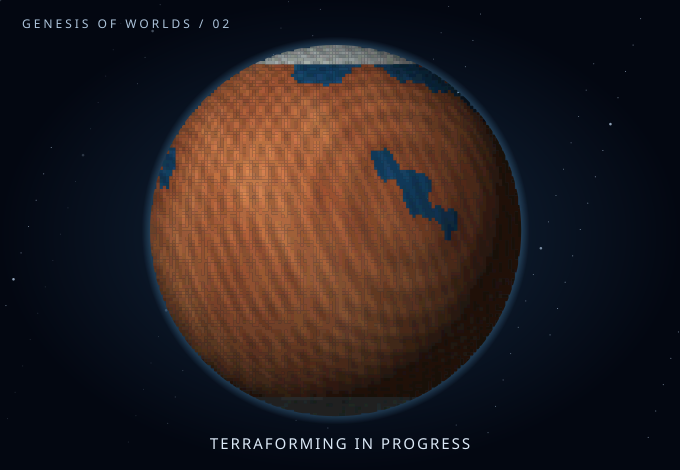

# Genesis of Worlds

### From a barren planet to a living world

| Barren Mars | Terraforming in progress | Habitable world |
| --- | --- | --- |
|  |  |  |

*Original procedural prototype illustrations rendered from the same terrain and shading model; not NASA photographs, scientific maps, or finished game screenshots.*

**Independent Game Studio — Project 05 | DEVELOPMENT PROTOTYPE | 2026-11-26**

A calm, original single-player planetary strategy and terraforming simulator inspired by the classic 2016–2018 TerraGenesis experience. The player turns a hostile world into a living, self-sustaining civilization and can continue playing after victory. Genesis of Worlds is a provisional working title, not a claim of affiliation, license, or access to the original game's source code.

## Vision

- Interactive rotating 3D globe with visible, continuous environmental transformation: barren terrain, ice, water, clouds, vegetation and city lights.
- Manage temperature, pressure, oxygen, water, biomass, population, economy, research and culture as interdependent systems.
- Establish cities and mining outposts, build facilities, unlock technology, respond to events, and eventually automate planetary equilibrium.
- Start with Mars and add progressively harder worlds; real scientific baselines where feasible, explicitly simplified game physics.
- Desktop browsers and Android; RU / EN / AZ; offline-first saves, adjustable simulation speed, optional offline progression. No advertising, purchases, subscription, mandatory login or pay-to-win.
- Original code, UI, art and balancing; third-party code/data only after provenance and license approval.

## Documentation

| Document | Purpose |
| --- | --- |
| [Game design](docs/GAME_DESIGN.md) | Full proposed systems, rules, features, UX and scope |
| [Research and source register](docs/RESEARCH.md) | Original game references, candidate open-source repositories, scientific data, license gates |
| [Technical architecture and QA](docs/ARCHITECTURE_QA.md) | Implementation options, state model, persistence, tests and release requirements |
| [Roadmap](docs/ROADMAP.md) | Ordered milestones and acceptance criteria |
| [Status](STATUS.md) | Authoritative current stage and next action |

## How the project changed

- **2026-11-25:** Owner requested a detailed GitHub concept as the fifth independent studio project following a nostalgic recollection of TerraGenesis. Research and design recorded; no game implementation or public release authorized. See [studio registry](../../GAME_REGISTRY.md).

- **2026-11-26:** Owner authorized Mars v0.1 implementation only. [Technical prototype](play/MarsPrototype_v0.1.html) (download and open locally), [engine research and design decision](docs/MARS_PROTOTYPE_V0_1.md). No release or deployment. Baseline Node + Chromium 21/21 PASS; independent QA remains open.

## Local-only distribution

Extract the development ZIP and open the HTML directly. No account, server, database or internet required at runtime. Export/import JSON to preserve progress when moving files or changing browser profiles. [Local-only product decision and MOLA build](docs/LOCAL_ONLY_AND_MOLA.md). Measured terrain package is pending verified build evidence.
