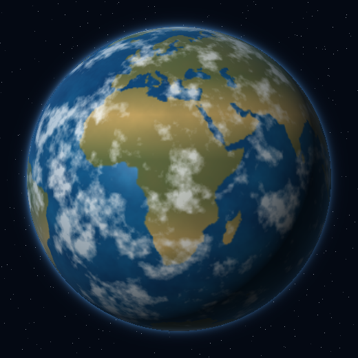
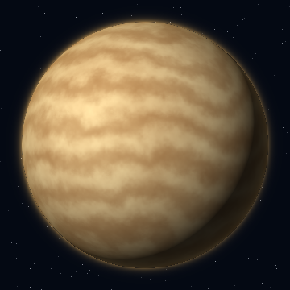
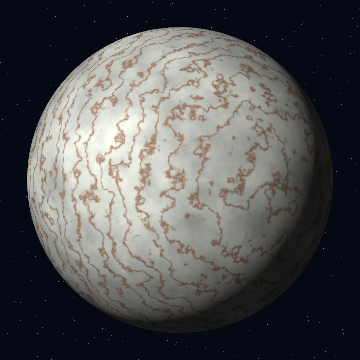
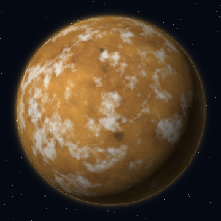
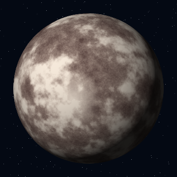
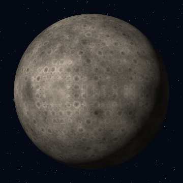
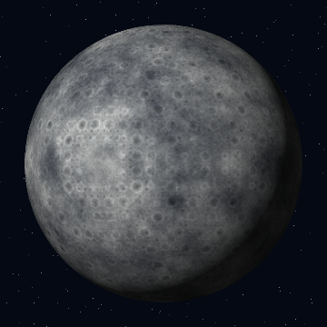
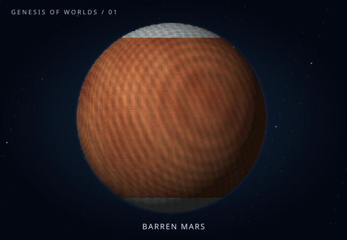
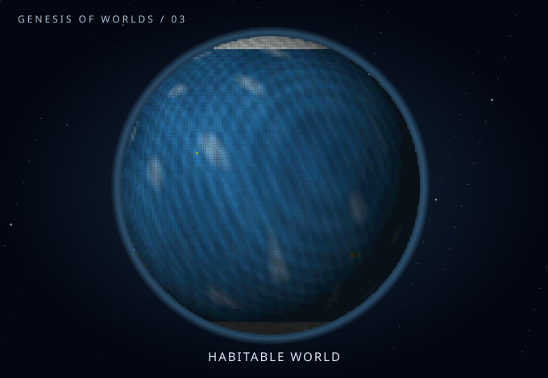

# Genesis of Worlds

**Create life on new worlds. Save civilization on Earth.**

### Featured challenge — [Earth: Save Civilization](docs/EARTH_SAVE_CIVILIZATION.md)

**Difficulty 5/5 · EXTREME · v0.7 visual development** — A fictional future Earth on the brink of ecological collapse. Restore the planet, protect its population and rebuild a sustainable civilization.

*On Mars, you create life. On Earth, you save it.*

*Earth: Save Civilization — original in-engine visual preview, with Natural Earth land outlines and fictional climate.*

### Explore the Solar System

| Venus | Europa | Titan |
| --- | --- | --- |
|  |  |  |
| Pluto | Mercury | Moon |
|  |  |  |

*Version 0.7 original renderer previews at initial scenario conditions, not satellite photographs or full-interface screenshots. Mars uses measured MOLA in the offline package; the historical Mars transformation illustrations below remain preserved. Final automated CI passed; independent visual acceptance remains separate.*

### From a barren planet to a living world

| Barren Mars | Terraforming in progress | Habitable world |
| --- | --- | --- |
|  |  |  |

*Original procedural prototype illustrations rendered from the same terrain and shading model; not NASA photographs, scientific maps, or finished game screenshots.*

**Independent Game Studio — Project 05 | DEVELOPMENT PROTOTYPE | 2026-11-26**

A calm, original single-player planetary strategy and terraforming simulator inspired by the classic 2016–2018 TerraGenesis experience. The player turns a hostile world into a living, self-sustaining civilization and can continue playing after victory. Genesis of Worlds is a provisional working title, not a claim of affiliation, license, or access to the original game's source code.

## Vision

- Interactive rotating 3D globe with visible, continuous environmental transformation: barren terrain, ice, water, clouds, vegetation and city lights.
- Manage temperature, pressure, oxygen, water, biomass, population, economy, research and culture as interdependent systems.
- Establish cities and mining outposts, build facilities, unlock technology, respond to events, and eventually automate planetary equilibrium.
- Eight selectable v0.5 worlds, from beginner Mars to extreme Pluto and Earth scenarios; five inherent difficulty tiers plus independent Beginner / Normal / Expert modes. World-specific acceptance and final balance remain separate.
- Desktop browsers and Android; RU / EN / AZ; offline-first saves, adjustable simulation speed, optional offline progression. No advertising, purchases, subscription, mandatory login or pay-to-win.
- Original code, UI, art and balancing; third-party code/data only after provenance and license approval.

## Documentation

| Document | Purpose |
| --- | --- |
| [Game design](docs/GAME_DESIGN.md) | Full proposed systems, rules, features, UX and scope |
| [Research and source register](docs/RESEARCH.md) | Original game references, candidate open-source repositories, scientific data, license gates |
| [Technical architecture and QA](docs/ARCHITECTURE_QA.md) | Implementation options, state model, persistence, tests and release requirements |
| [Earth: Save Civilization](docs/EARTH_SAVE_CIVILIZATION.md) | Flagship extreme-difficulty restoration campaign (v0.5 development) |
| [World selection and difficulty](docs/WORLD_SELECTION_AND_DIFFICULTY.md) | Eight worlds, five tiers, three modes, independent local campaigns |
| [Roadmap](docs/ROADMAP.md) | Ordered milestones and acceptance criteria |
| [Next development package](docs/V0_2_EXECUTION_PLAN.md) | Proposed implementation order, dependencies, acceptance gates |
| [Status](STATUS.md) | Authoritative current stage and next action |

## How the project changed

- **2026-11-25:** Owner requested a detailed GitHub concept as the fifth independent studio project following a nostalgic recollection of TerraGenesis. Research and design recorded; no game implementation or public release authorized. See [studio registry](../../GAME_REGISTRY.md).

- **2026-11-26:** Owner authorized Mars v0.1 implementation only. [Technical prototype](play/MarsPrototype_v0.1.html) (download and open locally), [engine research and design decision](docs/MARS_PROTOTYPE_V0_1.md). No release or deployment. Baseline Node + Chromium 21/21 PASS; independent QA remains open.

## Local-only distribution

Extract the development ZIP and open the HTML directly. No account, server, database or internet required at runtime. Export/import JSON to preserve progress when moving files or changing browser profiles. [Local-only product decision and MOLA build](docs/LOCAL_ONLY_AND_MOLA.md). **Verified development candidate:** [MOLA ZIP and screenshots](https://github.com/KonstantinOreshnikov/KonstantinOreshnikov/actions/runs/45768735048/artifacts/15092733115) · [procedural fallback](https://github.com/KonstantinOreshnikov/KonstantinOreshnikov/actions/runs/45768735048/artifacts/15092374018) · [QA and checksums](docs/P0_OFFLINE_QA.md). Actual MOLA elevation embedded; no runtime network requests. CI archives expire 2027-02-24; no permanent release or deployment.

## v0.2 in development

[Colony prototype](play/GenesisOfWorlds_v0.2.html) — local development branch, QA pending. Eight world entries (Mars playable, others Coming Soon), three modes, separate campaigns, local saves, construction and trade. [Implementation notes](docs/V0_2_IMPLEMENTATION.md). Verified v0.1 package remains preserved.

**v0.2 development candidate:** [ZIP + real browser screenshots](https://github.com/KonstantinOreshnikov/KonstantinOreshnikov/actions/runs/45772973094/artifacts/15094537949) · [QA and hashes](docs/V0_2_QA.md). Local-only, Mars playable; remaining worlds planned. No formal release. Archive expires 2027-02-24.

## v0.3 — Science and restoration (development)

[Prototype](play/GenesisOfWorlds_v0.3.html) · [Scope](docs/V0_3_IMPLEMENTATION.md). Dedicated QA pending; older candidates unchanged.

**v0.3 development candidate:** [ZIP + browser screenshots](https://github.com/KonstantinOreshnikov/KonstantinOreshnikov/actions/runs/45774541198/artifacts/15094714534) · [QA and hashes](docs/V0_3_QA.md) · [Fresh campaign reachability](docs/V0_3_FRESH_VICTORY.md). Local-only, Mars playable; remaining worlds planned. No formal release. Archive expires 2027-02-24.

## v0.4 planetary management (development)
[Prototype](play/GenesisOfWorlds_v0.4.html) · [Scope](docs/V0_4_IMPLEMENTATION.md). Mars only; QA pending.

**v0.4 development candidate:** [ZIP + browser screenshots](https://github.com/KonstantinOreshnikov/KonstantinOreshnikov/actions/runs/45775392754/artifacts/15095742662) · [QA and hashes](docs/V0_4_QA.md). Mars playable; other worlds planned. Temporary artifact expires 2027-02-24.

## v0.5 Solar System (development)
[Prototype](play/GenesisOfWorlds_v0.5.html) · [Scope](docs/V0_5_IMPLEMENTATION.md). Eight selectable worlds, Earth flagship in initial implementation; 24/24 fresh model victories; [world-specific CI](https://github.com/KonstantinOreshnikov/KonstantinOreshnikov/actions/runs/45786058933) pending browser result. Mars has measured MOLA; all other terrain and regional heights are procedural/game abstractions.

**v0.5 QA:** [initial CI](https://github.com/KonstantinOreshnikov/KonstantinOreshnikov/actions/runs/45786058933) · [corrected UI CI](https://github.com/KonstantinOreshnikov/KonstantinOreshnikov/actions/runs/45786437348) · [QA details](docs/V0_5_QA.md). Eight playable profiles; Earth rescue implemented, Mars measured MOLA only. Corrected local build tested for world-specific UI; final CI artifact pending. No formal release.

**Latest v0.5 verified development candidate:** [ZIP and browser screenshots](https://github.com/KonstantinOreshnikov/KonstantinOreshnikov/actions/runs/45786437348/artifacts/15101116049) · [QA and checksums](docs/V0_5_QA.md). Final corrected CI PASS. All eight worlds selectable; no release. Archive expires 2027-02-24.

## v0.6 Living Worlds (development)
[Prototype](play/GenesisOfWorlds_v0.6.html) · [Scope](docs/V0_6_IMPLEMENTATION.md). Seven tabs, Earth land outlines, refined globe and scenario operations. QA pending.

**v0.6 verified development candidate:** [ZIP and actual browser screenshots](https://github.com/KonstantinOreshnikov/KonstantinOreshnikov/actions/runs/45788305057/artifacts/15101726584) · [QA and hashes](docs/V0_6_QA.md). Seven tabs, Natural Earth land outlines, enhanced procedural globe, scenario operations; offline. Existing v0.5 JSON compatible; export before moving files. No formal release. Temporary archive expires 2027-02-24.

## v0.7 Planetary Visuals (development)
[Prototype](play/GenesisOfWorlds_v0.7.html) · [Visual scope](docs/V0_7_VISUAL_SCOPE.md). Final automated QA passed; existing gameplay unchanged.

**Latest v0.7 verified offline development candidate:** [ZIP and actual browser screenshots](https://github.com/KonstantinOreshnikov/KonstantinOreshnikov/actions/runs/45792360228/artifacts/15103101950) · [QA and checksums](docs/V0_7_QA.md). Download and extract `GenesisOfWorlds.html` to play locally. CI artifact is temporary; no account or hosted game server required. Previous builds retained.

## v0.8 Living Civilization (development)
[Scope](docs/V0_8_IMPLEMENTATION.md) · [HTML](play/GenesisOfWorlds_v0.8.html). Combined graphics and society/crisis implementation; QA pending. v0.7 remains verified baseline.

**Latest v0.8 verified development candidate:** [ZIP and actual browser screenshots](https://github.com/KonstantinOreshnikov/KonstantinOreshnikov/actions/runs/45804202713/artifacts/15108139401) · [QA](docs/V0_8_QA.md) · [Fresh campaign paths](docs/V0_8_FRESH_VICTORY.md). Offline. Export earlier JSON saves before upgrading. No formal release. Temporary artifact expires 2027-02-24.

## v0.9 development in progress
[Deep Strategy first slice](docs/V0_9_IMPLEMENTATION.md): differentiated crisis consequences and previews. v0.8 remains the last verified downloadable candidate. v0.9 is not released.

v0.9 adds optional fusion, logistics and orbital science megaprojects. [Intermediate crisis candidate](https://github.com/KonstantinOreshnikov/KonstantinOreshnikov/actions/runs/45817386493/artifacts/15115049032) verified; expanded build under [CI](https://github.com/KonstantinOreshnikov/KonstantinOreshnikov/actions/runs/45823405126). No formal release.

**Latest verified development candidate: v0.9 Deep Strategy.** [Offline ZIP](https://github.com/KonstantinOreshnikov/KonstantinOreshnikov/actions/runs/45823405126/artifacts/15118309413) · [QA evidence](docs/V0_9_QA.md). Independent acceptance and v0.9.5 balance pending. No formal release.
