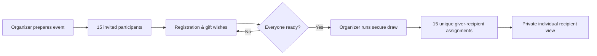

# Secret Santa 2026
### A privacy-aware gift exchange for a 15-person group

**Domain:** event coordination, user onboarding, preference capture and randomized assignment  
**Status:** completed draw, with live aggregate outcomes verified on **18 November 2026**.

## The challenge

Organize a group gift exchange without spreadsheet coordination, repeated messages or manual pair selection. Participants should be able to confirm their identity, submit gift preferences and privately learn whom to buy for. The organizer needs a reliable, auditable draw with no self-assignment.

## What was built

- A lightweight web interface for an invited group.
- Participant onboarding and identity/account linkage.
- Structured gift wishes: categories, preferred ideas and items to avoid.
- Organizer-controlled draw after participant readiness checks.
- Server-side assignment generation with cryptographically secure random bytes.
- A unique gift recipient for every giver, never the giver themselves.
- Relational persistence, row-level access controls and duplicate-draw safeguards.

## Verified live outcome

<small>Aggregate database validation performed 18 November 2026; no identifying records were extracted for this case study.</small>

| Metric | Verified |
|---|---:|
| Participants | **15** |
| Registered participants | **15 / 15** |
| Completed wishlists | **15 / 15** |
| Draw assignments | **15** |
| Unique gift givers / recipients | **15 / 15** |
| Self-assignments | **0** |
| Event state | **Drawn** |

These figures describe **one event**, not platform-wide traffic or generic support for a fixed maximum group size. No participant names, emails, preferences or actual pairings are displayed.

## How it works

## Engineering highlights

**Bias-aware randomness.** The database function uses cryptographically secure random bytes, a Fisher–Yates shuffle, rejection sampling to avoid modulo bias, and retries whole shuffles until no participant is assigned to themselves. This yields a uniform selection among valid derangements under the stated uniform-randomness assumption. The public case intentionally omits the privileged implementation.

**Guarded state changes.** The draw requires organizer authorization and completion prerequisites; a draw already marked complete cannot be rerun through the normal operation.

**Data privacy.** Assignment relationships and gift preferences remain in the private application. The public documentation uses aggregate counts and synthetic people only.

[System design](system-design.md) · [QA & synthetic demo](quality-and-demo.md)

## What is not claimed

No full independent security audit, formal cryptographic certification, long-term availability SLA or broader deployment scale is asserted. The 15/15 results are an actual checked snapshot, not synthetic marketing data.

---

**RU · Краткое описание:** веб-сервис «Тайный Санта» для 15 участников: регистрация, пожелания к подаркам, защищённая серверная жеребьёвка и приватный просмотр результата. Проверка базы подтвердила 15 регистраций, 15 готовых пожеланий, 15 уникальных назначений и 0 самоназначений. Реальные личности и пары не опубликованы.
