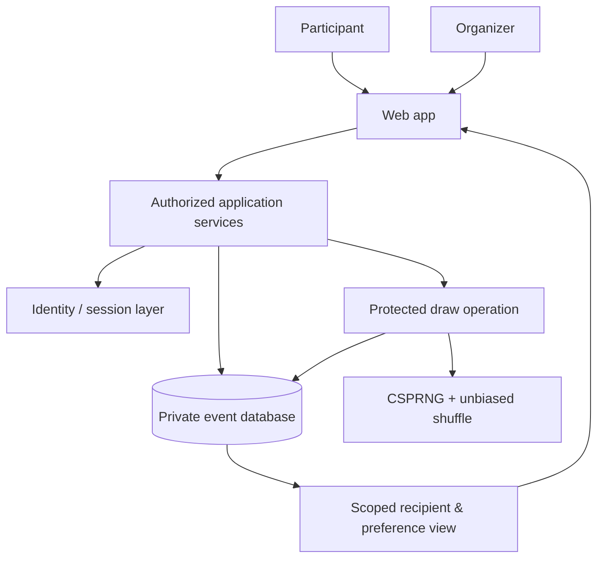
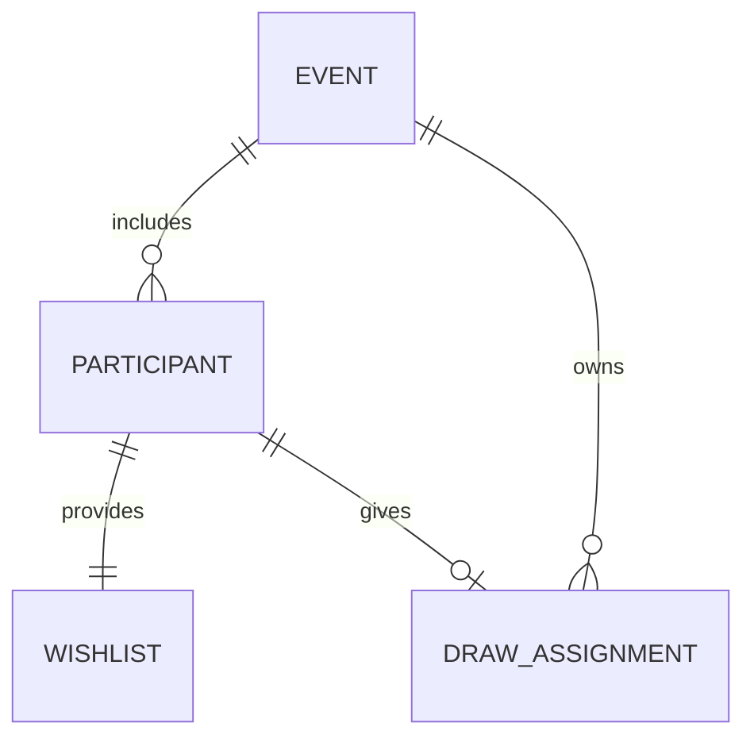
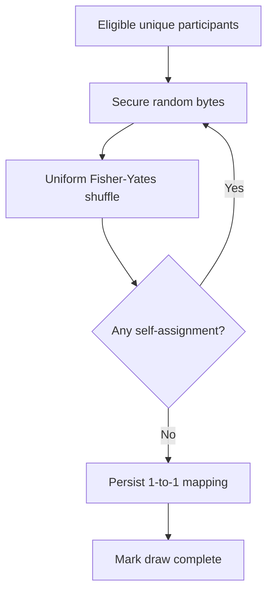

# Secret Santa — Generalized System Design

## 1. Components

The diagram is intentionally high-level. Internal endpoints, privileged database routines, access-policy details and real environment identifiers are not disclosed.

## 2. Minimal domain model

A separate private recipient reference in each assignment completes the one-to-one relationship. This model is **generalized** and deliberately not an exact reproduction of production DDL.

## 3. Draw invariants

For **N eligible participants** in an event:

1. Every participant appears once as a giver.
2. Every participant appears once as a recipient.
3. No giver is their own recipient.
4. The draw cannot be submitted as a second ordinary event operation after successful completion.
5. The operation is authorized and guarded by event readiness checks.

## 4. Randomization model

The underlying selection mechanism uses rejection sampling for bounded indices, avoiding the systematic bias introduced by directly taking a random integer modulo an arbitrary range. Rejecting a *complete permutation* if any fixed point occurs preserves uniformity among valid derangements, assuming the original shuffle is uniform.

This explanation is conceptual rather than a source-code dump. The checked event has 15 distinct givers, 15 distinct recipients and no self-pairs. One successful event does **not** substitute for a broad statistical or security certification.

## 5. Privacy choices

- Identity and preferences are handled by a private application.
- User-visible assignment information is scoped; the actual access policies are not part of the portfolio.
- Public materials contain only aggregate outcomes and invented participants.
- Event details, member lists and live service configuration are excluded.
